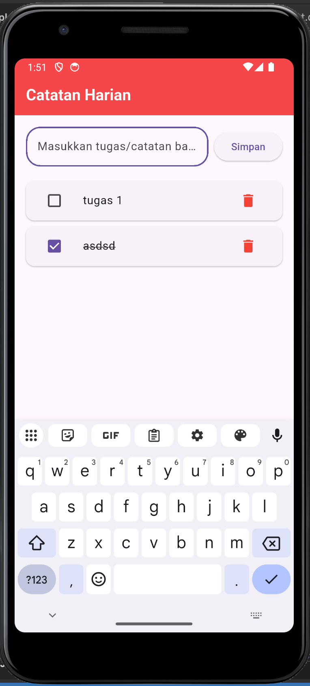

# Catatan Harian

Aplikasi mobile berbasis Flutter untuk mencatat daftar tugas atau catatan harian sederhana.

## Profil 
**Nama:**    : Harits
**NIM**     : 607012500069

## Fitur Utama

- **Input Data:** Menambahkan judul catatan/tugas baru melalui kolom input dan tombol simpan.
- **Tampilan Daftar (List):** Menampilkan daftar tugas yang telah ditambahkan secara langsung.
- **Aksi Sederhana:** Menandai tugas sebagai selesai (centang) dan menghapus tugas dari daftar.

## Screenshot Aplikasi


## Cara Menjalankan Aplikasi
1. Salin URL repositori berikut:
   ```text
   [https://github.com/Haritsdev0981/motion_rek.git](https://github.com/Haritsdev0981/motion_rek.git)
2. Buka VS Code atau Antigravity IDE, Buka Source Code: pilih Clone Repository -> paste link yang disalin tadi
3. Setelah masuk buka terminal
4. Masukkan perintah: flutter pub get
5. Langkah terakhir jalankan: flutter run

## Deklarasi Penggunaan AI
Apakah menggunakan AI? Ya

Tool AI yang digunakan: Gemini

Estimasi persentase kontribusi AI: 15%

Bagian kode/fitur yang dibantu AI:
Membantu penyusunan struktur awal komponen UI dan manajemen state sederhana (setState) pada file lib/main.dart.

Pernyataan:
"Saya menyatakan bahwa saya memahami alur dan fungsi dari seluruh kode yang ada dalam repositori ini"